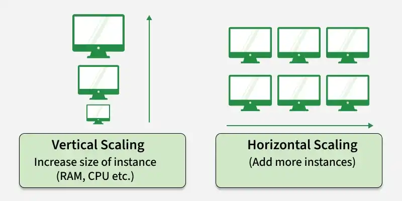
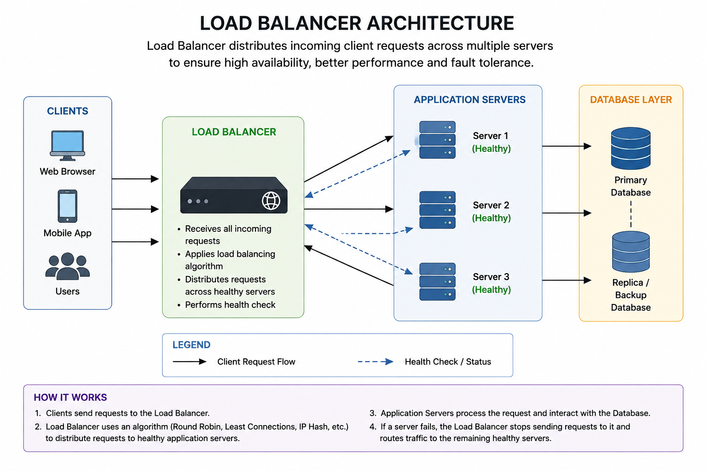

# Scalability

## Introduction

Scalability refers to the ability of a system to manage increasing workloads, users, or data without affecting performance.

## Real-World Example

### Amazon

Let us assume that currently 1,000 users visit a website every day. Now, if a festival comes and the load suddenly increases to 50,000 users a day, if Amazon fails to manage those users, they may lose millions of dollars. In order to get rid of these problems, they have to make the system scalable so that it can manage a large number of requests.

## Types of Scalability

There are two main types of scalability:

1. Vertical Scaling
2. Horizontal Scaling

## Vertical Scaling

It refers to the process of increasing the capacity or capability of an individual hardware or software component within a system.

Rather than adding more systems, we add more power by adding better processors, RAM, or other power-increasing adjustments.

### Advantages

- Easier management – It keeps our existing infrastructure while adding more computing power. Our existing code does not change.
- Increased capacity – A server's performance and ability to manage requests from users can be enhanced.

### Disadvantages

- It can cause a single point of failure. If a single server fails, the entire application may become unavailable.
- A server can be upgraded up to a certain limit.
- Upgrading hardware requires shutting down or restarting the server, causing downtime.

## Horizontal Scaling

It refers to the process of increasing the capacity and performance of a system by adding more instances or machines without changing the existing specifications and splitting the workload across different servers.

Instead of making one server more powerful, multiple servers work together to distribute the workload. A load balancer is used in horizontal scaling to receive incoming requests and distribute them among the servers. The load balancer decides which server should process each request. If any server fails, it distributes the requests to the other available servers.

### Advantages

- There is no single point of failure, as it distributes the workload across different servers.
- Increase the capacity to handle a larger number of incoming requests.
- Lowering the possibility of downtime, as we can add multiple servers without shutting down the system.

### Disadvantages

- Data synchronization – Keeping data consistent across multiple servers can be difficult.
- Load balancer failure – Load balancer failure can overload the same server, which can lead to the system crashing.
- Network dependency – Multiple servers need to communicate over the network, which can introduce latency or network-related problems.

## Conclusion

Scalability is an important characteristic of modern software systems because workloads can increase significantly over time. Vertical scaling increases the resources of an existing server, while horizontal scaling adds more servers to distribute the workload. Vertical scaling is generally simpler to manage but has hardware limitations and can create a single point of failure. Horizontal scaling provides greater flexibility and availability but introduces additional complexity, such as load balancing, data synchronization, and network communication. Therefore, the appropriate scaling approach should be selected based on the application's requirements, workload, cost, and expected growth.

## References

- [GeeksforGeeks – System Design: Horizontal and Vertical Scaling](https://www.geeksforgeeks.org/system-design/system-design-horizontal-and-vertical-scaling/)
- [Medium – Scalability: Vertical Scaling and Horizontal Scaling](https://medium.com/design-microservices-architecture-with-patterns/scalability-vertical-scaling-horizontal-scaling-adb52ff679f)
- [YouTube – Scalability and System Design](https://www.youtube.com/watch?v=TXJP0gzCXFQ&t=1900s)
